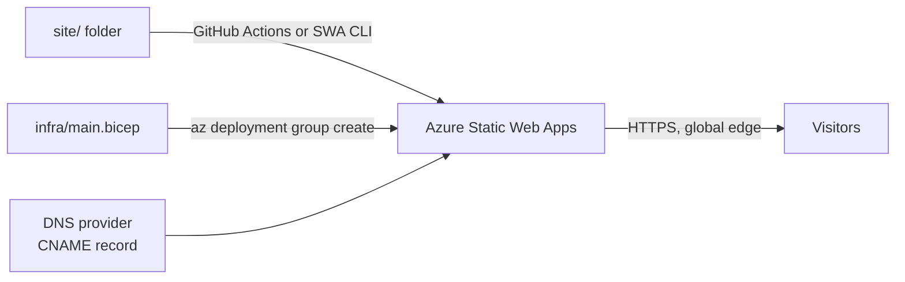

# Azure Static Web Apps starter: one-page professional website

A production-ready starter to publish a one-page professional website on Azure Static Web Apps, with infrastructure as code, continuous deployment, a custom domain, free HTTPS and a link preview for LinkedIn, Messenger and WhatsApp.

The demo site presents **Nubrivo Tech**, a fictional Azure and Microsoft 365 consulting firm.

## Why Azure Static Web Apps for a professional site

| Need | Answer |
|---|---|
| Look professional on your own domain | Custom domain with a free, auto-renewed TLS certificate |
| Near-zero running cost | Static hosting, no server, no database to patch |
| Fast everywhere | Content served from a globally distributed edge |
| Repeatable setup | Bicep template and GitHub Actions workflows |
| Shared on social networks | Open Graph tags and a 1200 x 630 preview image |

## Architecture



## Repository structure

```text
site/                       The website, deployed as is
  index.html                One-page template: hero, services, approach, engagements, contact
  404.html                  Not found page
  og-image.jpg              Link preview image, 1200 x 630
  robots.txt
  staticwebapp.config.json  Security headers, cache, 404 rewrite
infra/
  main.bicep                Static Web App, optional custom domain
  main.bicepparam           Parameters
.github/workflows/
  deploy-site.yml           Upload site/ on every push to main
  validate.yml              Build the Bicep template, check site files
docs/                       Step-by-step guides
```

## Quick start

```powershell
az login
az group create --name rg-demo-websites --location westeurope
az deployment group what-if --resource-group rg-demo-websites `
  --template-file infra/main.bicep --parameters infra/main.bicepparam
az deployment group create --resource-group rg-demo-websites `
  --template-file infra/main.bicep --parameters infra/main.bicepparam

$token = az staticwebapp secrets list --name swa-demo-cloud-site `
  --resource-group rg-demo-websites --query "properties.apiKey" -o tsv
npx.cmd @azure/static-web-apps-cli deploy ./site --deployment-token $token --env production
```

## Guides

| # | Guide | Topic |
|---|---|---|
| 01 | [Deploy from your PC](docs/01-deploy-cli.md) | Bicep or CLI, deployment token, upload |
| 02 | [Custom domain and HTTPS](docs/02-custom-domain.md) | CNAME at any DNS provider, free certificate |
| 03 | [Link preview](docs/03-link-preview.md) | Open Graph tags, Sharing Debugger |
| 04 | [Free or Standard plan](docs/04-free-vs-standard.md) | Limits, SLA, when to upgrade |
| 05 | [Troubleshooting](docs/05-troubleshooting.md) | Common errors on Windows |

## Continuous deployment with GitHub Actions

1. In the repository settings, add the secret `AZURE_STATIC_WEB_APPS_API_TOKEN` with the value of `$token`.
2. Push a change in `site/` to `main`. The [deploy workflow](.github/workflows/deploy-site.yml) uploads the site.

## Before going live

- [ ] Replace the demo content, contact details and company name.
- [ ] Update the design tokens at the top of `index.html` to match your brand.
- [ ] Update the Open Graph URLs and create a branded `og-image.jpg`.
- [ ] Remove `<meta name="robots" content="noindex, nofollow">` from `index.html`.
- [ ] Switch to the Standard plan for the SLA.

## License

[MIT](LICENSE)
